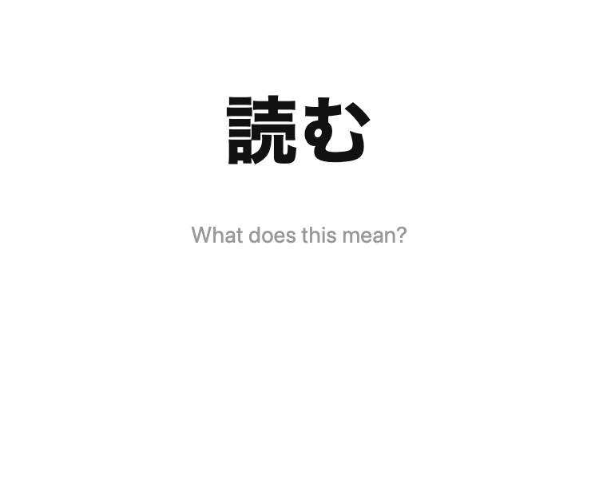
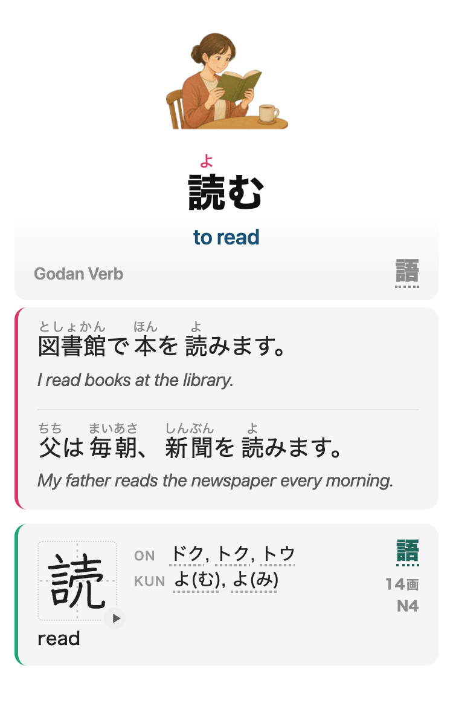
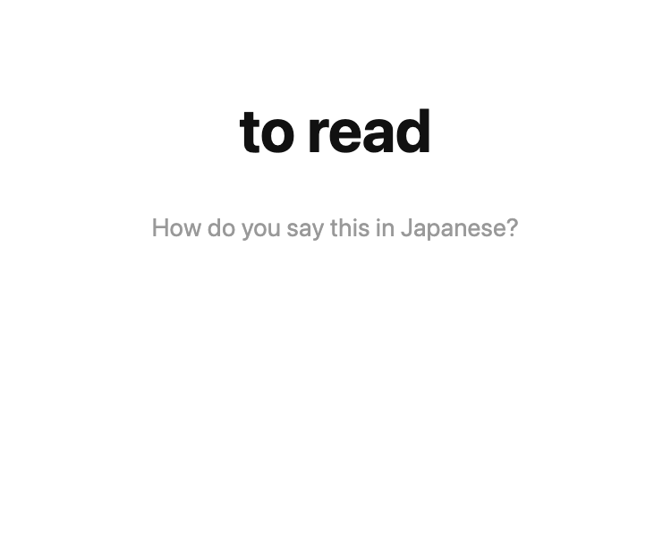
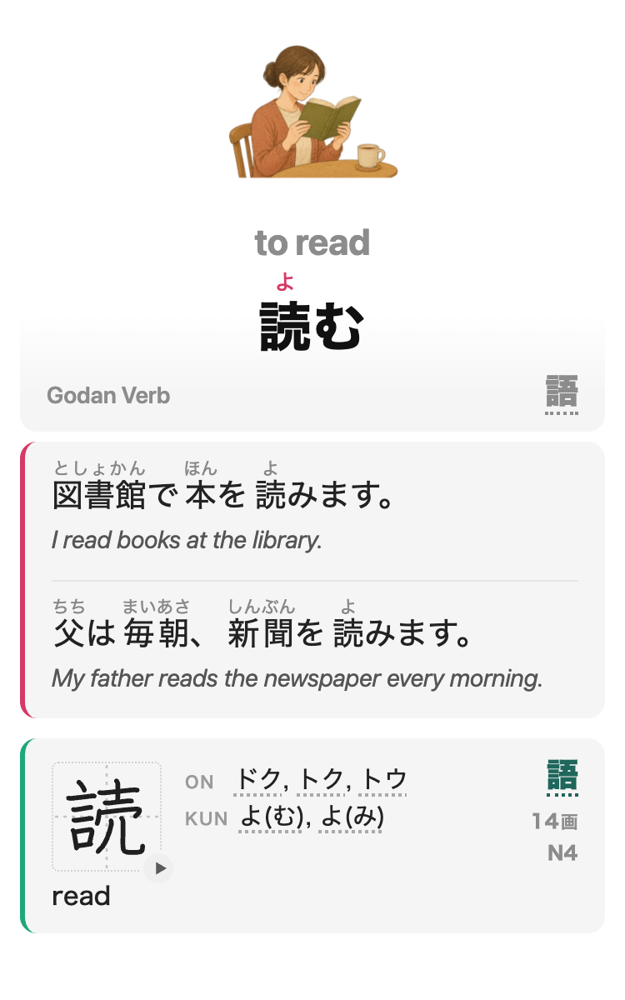
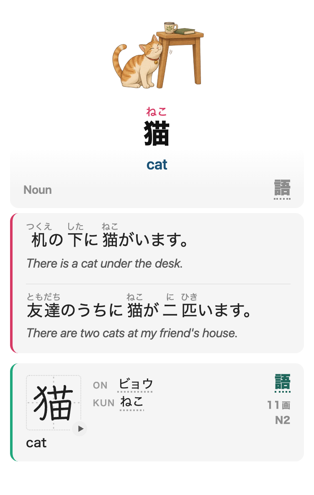

# Japanese vocabulary decks for Anki

The deck exports are in [`decks/`](decks/). Choose a deck for your textbook or JLPT level. Each download includes the vocabulary, illustrations, and recordings for the words and example sentences.

| Download | Coverage | Vocabulary notes | File size |
|---|---|---:|---:|
| [GENKI I (.apkg)](https://github.com/zacharyhalvorson/anki-decks/raw/refs/heads/main/decks/GENKI%20I%20Vocab.apkg) | Lessons 1–12 | 660 | 76 MB |
| [GENKI II (.apkg)](https://github.com/zacharyhalvorson/anki-decks/raw/refs/heads/main/decks/GENKI%20II%20Vocab.apkg) | Lessons 13–23 | 589 | 111 MB |
| [Quartet I (.apkg)](https://github.com/zacharyhalvorson/anki-decks/raw/refs/heads/main/decks/Quartet%20I%20Vocab.apkg) | Lessons 1–2 | 175 | 39 MB |
| [JLPT N5 (.apkg)](https://github.com/zacharyhalvorson/anki-decks/raw/refs/heads/main/decks/JLPT%20N5.apkg) | Beginner vocabulary | 751 | 106 MB |
| [JLPT N4 (.apkg)](https://github.com/zacharyhalvorson/anki-decks/raw/refs/heads/main/decks/JLPT%20N4.apkg) | N4 vocabulary | 1,150 | 179 MB |

## Card examples

Each vocabulary note gives you **two cards: Recognition and Production**. Production uses an English cue, or a picture for selected concrete words with an unmistakable visual meaning. The table shows both Production variants.

| Card | Question | Answer |
|---|---|---|
| **Recognition · Japanese → English** Recall the meaning of 読む. |  |  |
| **Production · English → Japanese** Recall the Japanese for “to read.” |  |  |
| **Production · Picture → Japanese** Name the pictured animal: 猫. |  |  |

Examples are browser renders of the exported GENKI I cards at phone width. Anki's review buttons are outside the card and aren't shown.

On the answer, tap the word to replay its audio or either example sentence to hear that sentence. Tap a kanji box to replay its stroke order, or an underlined on'yomi or kun'yomi to hear the reading. Tap the question to reveal the answer; use Anki's rating buttons to move on.

## Add a deck to Anki

### iPhone or iPad

1. Install [AnkiMobile Flashcards from the App Store](https://apps.apple.com/app/id373493387).
2. In Safari, choose a `.apkg` download from the table above and wait for the download to finish. Each package includes its images and audio.
3. Open **Files → Downloads** (or the folder you saved it to), then tap the `.apkg` file to open it in AnkiMobile. If needed, touch and hold the file, choose **Share**, and select **Anki**; look under **More** if it isn't listed.
4. Complete the import in AnkiMobile, then open the deck to start studying.
5. To study on other devices, sign into the same [AnkiWeb account](https://ankiweb.net/) in each Anki app and sync after importing.

For an updated deck, import the newer `.apkg` into the same collection. Matching notes update in place, preserving your existing review progress. See [Anki's packaged-deck import guide](https://docs.ankiweb.net/manual/importing/packaged-decks).

### Computer or web browser

Install [Anki for macOS, Windows, or Linux](https://apps.ankiweb.net/), open it, and choose **File → Import** to select the downloaded `.apkg`. Sync with AnkiWeb to access the cards in AnkiMobile or study at [AnkiWeb](https://ankiweb.net/). AnkiWeb itself does not import `.apkg` files.

## Open dictionary entries in Nihongo

Install [Nihongo – Japanese Dictionary from the App Store](https://apps.apple.com/app/id881697245) for direct dictionary lookups while reviewing on iPhone or iPad. Nihongo is optional; you can study the decks in Anki without it.

- Tap the **grey 語** beside the part of speech to look up the full word.
- Tap the **green 語** beside a kanji's stroke count to open that kanji's entry.

These links open Nihongo when it is installed. Otherwise, they open a webpage with an App Store link. See [Nihongo's app-link guide](https://nihongo-app.com/faq.html#app-links).

[GENKI I coverage and build notes](assets/genki1/README.md) · [Cards without illustrations](assets/genki1/text-only-notes.md) · [Card features and data sources](docs/deck-guide.md) · [Maintaining the decks and creating matching artwork](AGENTS.md)
